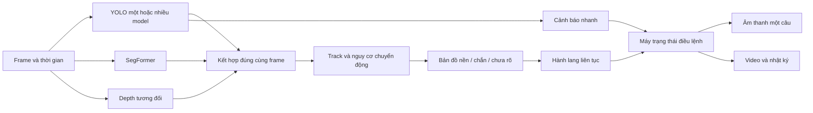

# Guide v2 — lõi nhận diện và tránh vật cản cục bộ

Bản này ưu tiên **phân tích video trên Kaggle GPU**. Không thay thế desktop hiện tại, không huấn luyện lại, không tự đổi model mặc định. Có ba model mặc định: YOLOv8n ROD, SegFormer B0 ADE20K và Depth Anything V2 Small. YOLO26n có sẵn để so sánh.

## 1. Các tệp dùng ngay

- `kaggle_demo_yolo_segformer.ipynb`: notebook mới, chỉ gọi lõi chung.
- `configs/guide_kaggle.json`: đường dẫn model, bối cảnh, kích thước và chế độ.
- `guide_core/`: adapters → fusion → BoT-SORT → corridor → policy → audio/render.
- `tools/annotate_guide.html`: mở bằng trình duyệt trên laptop để gán nhãn video.
- `tools/compare_guide_models.py`: so sánh cùng khung hình.
- `tools/package_guide_kaggle.py`: đóng gói theo danh sách cho phép; không lấy môi trường Python, token hay dữ liệu không liên quan.
- `notebooks/archive/kaggle_demo_yolo_segformer.legacy.ipynb`: bản notebook cũ để đối chiếu, không dùng cho lõi mới.

Tất cả lệnh dưới đây chạy tại thư mục dự án. Trên Windows dùng `.venv\Scripts\python.exe` thay cho `python` nếu chưa kích hoạt môi trường. Đường dẫn trong cấu hình được tính từ **thư mục đang chạy**, không từ thư mục chứa JSON.

## 2. Chạy trên Kaggle

1. Tải `dist/guide_kaggle_v2_models.zip` thành một **Kaggle Dataset riêng tư**, rồi Add Input vào notebook. Thêm một video bạn tự quay hoặc được phép dùng làm Input riêng.
2. Import `kaggle_demo_yolo_segformer.ipynb`. Bật GPU T4 và Internet.
3. Chạy ô đầu để xem đường dẫn Input. Sửa **BUNDLE_SOURCE** thành file ZIP hoặc thư mục chứa `bundle_manifest.json`. Kaggle có thể dùng đường dẫn lồng `/kaggle/input/datasets/<owner>/<slug>`; không đoán đường dẫn.
4. Chạy ô cài thư viện. Notebook giữ phiên bản PyTorch/CUDA đang có, chỉ cài phụ thuộc với ràng buộc bảo vệ torch/torchvision/torchaudio.
5. Điền **VIDEO_PATH**, rồi chọn **PRIMARY**, **ENVIRONMENT**, **MODE** và **MAX_SECONDS**. Dùng 6 giây để chạy thử, sau đó đặt **MAX_SECONDS = None** khi cần chấm toàn bộ video.
6. Chạy ô kiểm tra tương thích. Phải không có `failures`. Sau đó mới chạy ô xuất video.
7. Xem `demo.mp4` ngay trong notebook; tải ZIP đầu ra từ Output. Lưu phiên khi hoàn tất.

Đoạn `val1_excerpt.mp4` đã dùng để thử cục bộ. Gói hiện tại chỉ gồm mã, model và âm thanh. Video dùng để đánh giá được chọn qua **VIDEO_PATH**.

Lựa chọn bối cảnh:

| Bối cảnh | Mặt nền ứng viên | Giới hạn |
|---|---|---|
| `sidewalk` | sidewalk/walkway/footpath/pavement | Không coi đường xe là lối đi |
| `alley` | các lớp trên và road | Road có rủi ro giao thông; có xe thì không xác nhận hướng |
| `indoor` | floor/flooring | Chỉ dùng floor trong nhà |

`mirror_input=true` chỉ khi nguồn ảnh bị lật gương. Lõi sửa ảnh trước khi chạy tất cả model, nên trái/phải cùng một hệ tọa độ.

## 3. Chạy trên laptop để kiểm tra

Môi trường phải có PyTorch hoạt động trước. Không thay gói torch đang chạy ổn chỉ để cài phần mới.

```powershell
.venv\Scripts\python.exe -m pip install -r requirements-guide-core.txt
.venv\Scripts\python.exe tools/check_guide_environment.py --config configs/guide_kaggle.json --video data/guide_demo/val1_excerpt.mp4
.venv\Scripts\python.exe -m guide_core.demo --config configs/guide_kaggle.json --video data/guide_demo/val1_excerpt.mp4 --environment sidewalk --output runs/guide_v2/my_demo
```

Chọn thư mục output mới mỗi lần để không ghi đè phép đo cũ.

Model depth đã được tải vào `models/depth_anything_v2_small`; `source.json` lưu revision. Nếu thiếu:

```powershell
.venv\Scripts\python.exe tools/download_guide_depth.py
```

Đây là [Depth Anything V2 Small chính thức](https://huggingface.co/depth-anything/Depth-Anything-V2-Small-hf), loại **relative depth**. Bản đồ càng sáng thể hiện gần hơn tương đối trong ảnh; không phải khoảng cách mét và không so trực tiếp độ sáng giữa hai khung. Depth dùng để loại vùng đứt quãng/chưa rõ, không chứng minh bề rộng khe hoặc độ sâu hố.

## 4. Cách lõi hoạt động



- Adapter có `load / predict / close`; nạp một lần. Đăng ký adapter bằng `register` và khai báo cấu hình, không sửa bộ quyết định.
- Đầu ra phải mang cùng session, frame ID và phép đổi hình. Sai frame/geometry bị từ chối.
- Nhãn detector được chuẩn hóa trước khi loại trùng IoU. Giữ nguồn model; lấy điểm mạnh nhất, không cộng độ tin cậy.
- [BoT-SORT](https://docs.ultralytics.com/modes/track/) dùng sparse optical flow, ReID tắt. Hộp vừa quan sát luôn dùng ngay; hộp Kalman dự đoán không xác nhận đường trống.
- Dự báo 0,5 giây mở rộng vùng bị chắn. Track không quan sát không được dùng như bằng chứng hiện tại. Mất quan sát/cắt cảnh/chuyển động camera mạnh hủy xác nhận.
- Giữ semantic map đầy đủ. Door không nghĩa là cửa mở; Manhole không tự đổi thành hố hở.
- Tìm đường trên lưới, bắt đầu ở nền gần giữa ảnh; không cắt qua vùng chưa rõ hoặc bị chắn. Ưu tiên khoảng trống nhỏ nhất lớn nhất, rồi ít đổi hướng. Khoảng đệm là đơn vị ảnh, không phải kích thước cơ thể.
- Hướng cần ít nhất 3 khung khác nhau trong ít nhất 0,4 giây thời gian nguồn. Hành lang đổi mạnh phải xác nhận lại. Không tự chọn trái khi hai hướng tương đương.
- Hẹp/chưa xác nhận được: SLOW hoặc UNCLEAR. Vật cản gần giữa ảnh hoặc hướng vừa bị chắn: STOP. Không có lệnh lùi/quay đầu.

Các ngưỡng hiện là **giá trị khởi đầu chưa tối ưu trên validation**. Không hạ ngưỡng chỉ để video có nhiều lệnh trái/phải.

## 5. Offline và phát lại thời gian thực

**Offline:** lấy mẫu tối đa 10 FPS; các model cùng xử lý một khung; tracking và cảnh báo dùng thời gian video. Video MP4 phát đúng thời gian nguồn dù máy xử lý chậm. Tốc độ xử lý nằm trong report, không suy từ FPS của MP4.

**Realtime replay:**

```powershell
.venv\Scripts\python.exe -m guide_core.demo --config configs/guide_kaggle.json --video data/guide_demo/val1_excerpt.mp4 --mode realtime_replay --output runs/guide_v2/replay
```

Nguồn được phát đúng thời gian, chỉ giữ khung mới nhất. Một công việc detector và một công việc context tối đa; khóa theo thiết bị ngăn GPU chạy chồng. Detector được ưu tiên khi GPU rảnh, nhưng không thể ngắt một kernel đang chạy. Cảnh báo detector không phải đợi **kết quả** semantic/depth. Context chậm hơn 700 ms không xác nhận hướng.

Phát lại kiểm tra thuật toán theo thời gian thực, **không phát loa thật**: âm thanh được ghép vào MP4 sau đó. Các số về “gửi thiết bị âm thanh” là null nếu chưa có backend loa. AudioTimeline có điểm nối `sink.submit / sink.stop` cho giai đoạn desktop/web; chưa chuyển các ứng dụng cũ sang lõi này.

## 6. Âm thanh và bằng chứng

Bộ Khánh Vy riêng trong `assets/audio/guide_core/khanh_vy` gồm: Dừng, Chậm, Chưa xác nhận lối đi, Giữ hướng đi chậm, Lệch nhẹ trái/phải, Lối đi hẹp.

**Dừng lại**, **Lệch nhẹ sang trái** và **Lệch nhẹ sang phải** cùng mức ưu tiên khi chọn câu tiếp theo. Mỗi câu đã bắt đầu được đọc hết. Hệ thống giữ một câu chờ và kiểm tra hạn trước khi phát. Một chỉ dẫn chờ bị loại khi hướng đó mất hiệu lực.

Nếu bộ nhận diện ra lệnh Dừng trong lúc đang đọc câu khác, câu Dừng được đưa vào hàng chờ. Xuất MP4 giữ khung cuối nếu cần để phát hết câu đang đọc. Người dùng vẫn có thể ngắt bằng thao tác tắt tiếng hoặc dừng ứng dụng.

Đầu ra:

| Tệp | Nội dung |
|---|---|
| `demo.mp4` | Hộp, semantic, depth, hành lang nếu xác nhận, phụ đề Việt và âm thanh |
| `decisions.jsonl` | Quyết định, lý do, frame, nguồn model, hộp/track và thời gian |
| `audio_events.jsonl` | Yêu cầu, thay câu chờ, bắt đầu lịch phát, hủy, hết hạn |
| `speech_segments.json` | Khoảng thực tế được ghép vào file, kể cả câu bị cắt |
| `report.json` | FPS giải mã/xử lý, thời gian model, RAM/VRAM, lỗi, hash model/video |
| `config.json` | Cấu hình chính xác của lần chạy |
| `voice.wav` | Âm thanh đã ghép theo thời gian video |

`scheduled` là đã xếp vào video; chỉ backend loa mới có `submitted_to_device`. Không gọi những mốc đó là lúc người dùng thực sự nghe.

## 7. Gán nhãn và đánh giá

1. Thu video đúng góc camera ngang ngực: hẻm hai tường, lối hẹp, đông vật cản, người/xe ngang, bậc/lề, tối, rung, thông thoáng.
2. Chọn địa điểm/phiên riêng cho validation/test từ trước. Không chia khung liên tiếp giữa hai tập.
3. Mở `tools/annotate_guide.html` bằng trình duyệt. Video chỉ được đọc trên máy.
4. Chọn video, nhập phiên/địa điểm/tập; đánh dấu bắt đầu/kết thúc.
5. Chọn loại khoảng, các hành động được phép, các hướng bị cấm. Một khoảng “có thể chỉ hướng” phải có hướng đúng, để hệ thống luôn dừng không được tính là chỉ dẫn tốt.
6. Xem lại, đánh dấu đã kiểm tra, tải JSON.
7. Kiểm tra chia tập và chấm:

```powershell
python tools/check_guide_splits.py data/events/validation.json data/events/test.json
python -m guide_core.evaluate --annotations data/events/validation.json --run runs/guide_v2/my_demo
```

8. Để tính chỉ số trên nhiều video, sao chép `data/guide_eval_manifest.template.json` thành `data/guide_validation.json` và điền một cặp tệp nhãn + thư mục đầu ra cho mỗi video. Đường dẫn trong manifest được tính từ vị trí tệp manifest. Chạy `python -m guide_core.evaluate --manifest data/guide_validation.json`. Lặp lại với manifest riêng cho test. Công cụ cộng số sự kiện và thời lượng thông thoáng trước khi tính tỷ lệ, đồng thời từ chối video trùng hoặc cấu hình khác trong cùng một báo cáo.

Tệp nhãn mới có mã SHA-256 của video khi trình duyệt hỗ trợ Web Crypto. Cách này phát hiện nhầm giữa hai bản video cùng tên. Tệp nhãn cũ vẫn có thể chấm bằng tên. Công cụ kiểm tra chia tập còn đối chiếu mã phiên, địa điểm và SHA-256 nếu đã ghi.

Không có nhãn thì chỉ báo smoke test. Bộ nhỏ hơn 100 nguy hiểm hoặc 30 phút thông thoáng luôn đánh dấu sơ bộ. Chấm cả quyết định lẫn câu ghép âm thanh, kể cả hướng đang đọc đi vào khoảng nguy hiểm.

## 8. So sánh và lựa chọn model

```powershell
python tools/compare_guide_models.py --config configs/guide_kaggle.json --video data/guide_demo/val1_excerpt.mp4 --output runs/guide_v2/compare --seconds 6 --sizes 320 480 640
```

Mỗi cấu hình dùng cùng mã khung; nếu khác thì công cụ dừng. Thử detector v8/26 riêng, thêm segmentation, thêm depth, thêm detector thứ hai. Dùng `--annotations` để chấm khi đã có nhãn và xử lý đủ toàn bộ thời lượng.

Chọn model/ngưỡng bằng validation. Sau đó đánh giá test độc lập. Giữ model cũ; không có bước tự ghi đè `best.pt`.

Mục tiêu: recall cảnh báo sự kiện ≥90%, cảnh báo sai ≤0,2/phút, không có hướng sai vào vùng nguy hiểm đã gán nhãn, đồng thời báo tỷ lệ chỉ được hướng đúng. Mục tiêu p95 ≤700 ms cần đo **tới gửi loa thật khi loa rảnh**; video demo không đủ chứng minh chỉ số này.

## 9. Đóng gói lại

```powershell
python tools/package_guide_kaggle.py --output dist/guide_kaggle_v2_models.zip
```

Gói chỉ gồm mã cần chạy, config, model được chỉ định, clip Khánh Vy và video được chọn. Không chứa venv, .env, bộ dataset, cache tải hoặc notebook lịch sử. File ZIP dùng tên POSIX và có SHA256 manifest.

Kiểm thử lõi:

```powershell
python -m unittest discover -s tests -p test_guide_core.py -v
```

Đây là công cụ nghiên cứu/demo có giám sát. Phép đo video và depth tương đối chưa xác nhận an toàn sử dụng để đi bộ độc lập.

